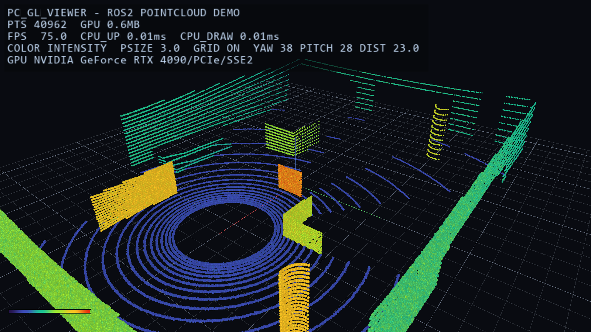
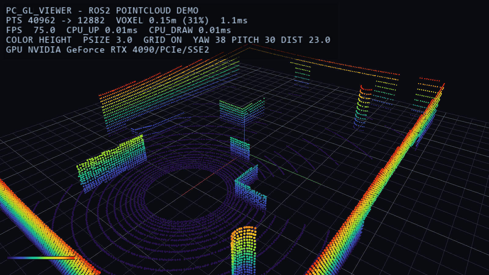
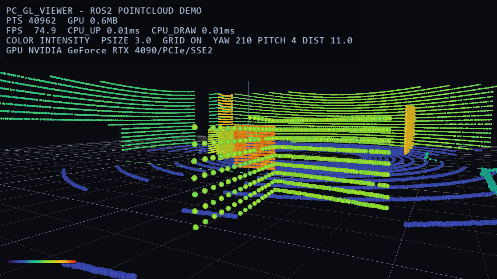
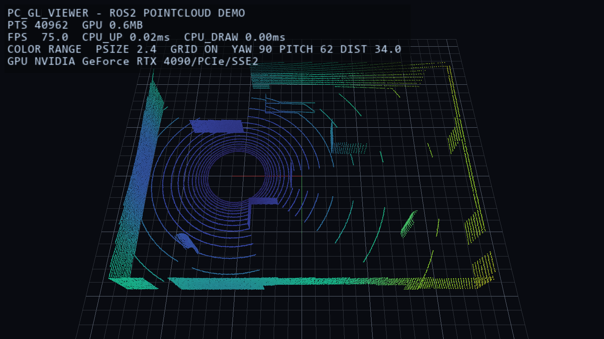
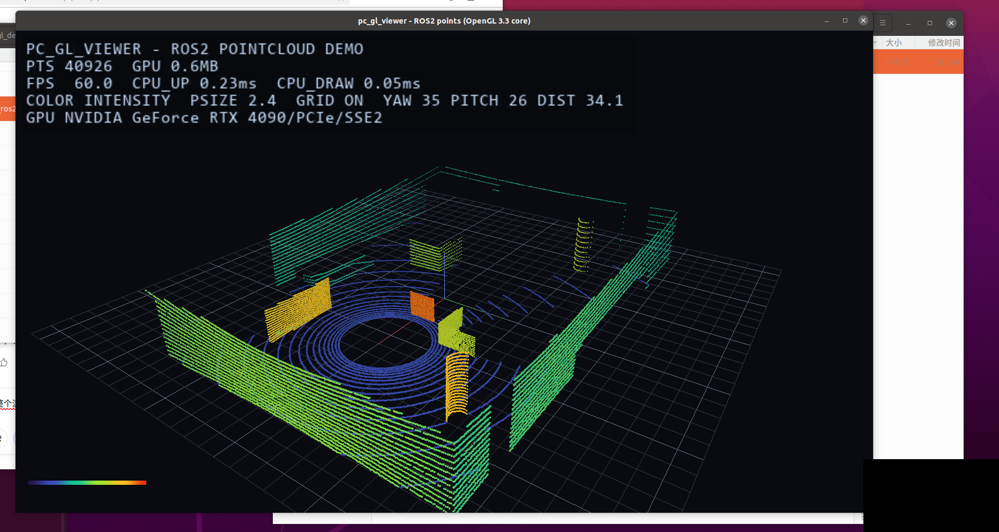

# pc_gl_viewer — ROS2 点云 + OpenGL 可视化 Demo

一个**零第三方渲染依赖**的 ROS2 点云可视化 demo：自写 32 线激光雷达仿真发布 `sensor_msgs/PointCloud2`，
订阅端手写解码 + 体素降采样，用 **OpenGL 3.3 Core + GLSL** 实时显示（点精灵、turbo 调色板、轨道相机、HUD）。



| 高度着色 + 体素降采样 | 贴地视角 | 距离着色（俯视） |
|---|---|---|
|  |  |  |

扫描动画（平台绕场运动，遮挡关系逐帧变化）：`docs/demo.gif` ｜ 视频版：`docs/pc_gl_viewer_demo_6s.mp4`
一页项目说明（PDF，可直接作为作品附件）：[`docs/demo_one_pager.pdf`](docs/demo_one_pager.pdf)

---

---

## . 目录结构

```
ros2_pc_gl_demo/
├─ ros2_ws/src/pc_gl_viewer/          # ROS2 包（主交付物）
│  ├─ package.xml / CMakeLists.txt
│  ├─ launch/pc_gl_viewer.launch.py   # 一键起发布 + 查看
│  ├─ include/pcview/                 # 核心：数学/相机/点云/编解码/滤波/渲染/HUD/GL 加载器
│  ├─ include/pc_gl_viewer/           # ROS 侧：发布节点/订阅节点/消息适配器
│  ├─ src/core/                       # 与平台无关的核心实现（不含 ROS）
│  ├─ src/ros/                        # 两个节点（类与 main 分离，便于测试）
│  ├─ src/platform/glfw_window.cpp    # Linux 平台层（GLFW）
│  ├─ tools/ros2_stub_check/          # 桩头文件 + 数据链路回环测试
│  └─ tools/gen_font_atlas.py         # HUD 位图字体图集生成
├─ windows_preview/                   # 无 ROS 的 Windows 验收程序（Win32 + WGL）
├─ scripts/
│  ├─ build_windows.cmd               # Windows 构建（vcvars + CMake/Ninja）
│  ├─ check_ros2_stubs.cmd            # 无 ROS 时的编译校验
│  ├─ run_stub_loopback.cmd           # 无 ROS 时的数据链路回环测试
│  └─ setup_ubuntu_ros2.sh            # Ubuntu 侧依赖 + 构建
└─ docs/                              # 截图、GIF、字体图集、Ubuntu 部署提示词
```

## . 数据流

```
pc_cloud_publisher                       pc_gl_viewer
┌─────────────────────┐   /points        ┌──────────────────────────────────────┐
│ 32 线雷达仿真        │  PointCloud2     │ decode_point_cloud2（字段/步长/NaN）  │
│ 射线求交 + 遮挡      │ ───────────────▶ │ → voxel_grid_downsample（可选）       │
│ 丢包 + 测距噪声      │  SensorDataQoS   │ → glBufferData 上传 VBO              │
│ encode_point_cloud2 │                  │ → GLSL：turbo 调色板 + 圆形点精灵     │
└─────────────────────┘                  │ → HUD（FPS/点数/着色模式/图例）       │
                                         └──────────────────────────────────────┘
```

线程模型：ROS executor 在独立线程 spin；**所有 GL 调用只在主线程**；
`ViewerApp::submit_cloud` 用 mutex 交接"待渲染点云"。

---

## . 运行方式 A：Windows（无 ROS，用于渲染验收）

需要 Visual Studio 2019/2022（C++ 桌面开发负载）+ CMake。

```bat
scripts\build_windows.cmd
build\pc_gl_viewer_preview.exe --selftest      :: 逻辑自检（无窗口、不碰 GPU）
build\pc_gl_viewer_preview.exe                 :: 交互浏览
```

截图 / 序列：
```bat
build\pc_gl_viewer_preview.exe --capture docs\hero_intensity.bmp --yaw 38 --pitch 28 --dist 23 --point-size 3
build\pc_gl_viewer_preview.exe --capture docs\hero_height_voxel.bmp --color 1 --voxel 0.15 --dist 23
build\pc_gl_viewer_preview.exe --capture-seq docs\frames\f --frames 30 --width 1000 --height 600
```

## . 运行方式 B：Ubuntu + ROS2（主路径）

本机实测环境：**Ubuntu 20.04 + ROS2 Foxy + RTX 4090**（见本节末尾截图）。
代码同时兼容 Humble（22.04）与 Jazzy（24.04）——只依赖 `rclcpp` + `sensor_msgs`，没有版本相关 API。

```bash
sudo apt install -y libglfw3-dev libgl1-mesa-dev python3-colcon-common-extensions
source /opt/ros/humble/setup.bash            # 24.04 用 jazzy；20.04 用 foxy
cd ros2_ws
colcon build --packages-select pc_gl_viewer --cmake-args -DCMAKE_BUILD_TYPE=Release
source install/setup.bash

ros2 launch pc_gl_viewer pc_gl_viewer.launch.py
# 另一个终端
ros2 topic hz /points                       # 预期 ~10 Hz
ros2 topic echo /points --once --field width
```

参数化：
```bash
ros2 launch pc_gl_viewer pc_gl_viewer.launch.py voxel:=0.15 color_mode:=1 rings:=64
ros2 run pc_gl_viewer pc_cloud_publisher    # 只跑发布端
ros2 run pc_gl_viewer pc_gl_viewer          # 只跑查看器（可订阅任何 PointCloud2 源）
```



> Ubuntu 20.04 / ROS2 Foxy 下 `ros2 launch` 的真实窗口：`PTS 40926`、`FPS 60`、RTX 4090。
> 话题侧实测（`ros2 topic echo`）：`width: 41563`、`point_step: 16`、`row_step: 665008`（= 41563×16）、
> `frame_id: lidar_link`、字段 `x/y/z/intensity` 偏移 0/4/8/12。

> 常见问题：`pkg_check_modules(GLFW3)` 失败 → 少 `libglfw3-dev`；`glfwCreateWindow` 失败 → 没有图形会话
> （ssh 无 X 转发 / 缺 WSLg）；`glxinfo` 显示 `llvmpipe` 说明是软件渲染（能跑但帧率低）；
> `ros2 topic hz /points | head` 打印 `BrokenPipeError` 是无害的（`head` 提前关管道）。
> 小提示：`ros2 topic hz /points | head` 会打印 `BrokenPipeError`，那是 `head` 提前关管道导致的，无害。

## . 操作

| 输入 | 作用 |
|---|---|
| 左键拖动 | 轨道旋转 |
| 右键拖动 | 平移 |
| 滚轮 | 缩放 |
| `1`/`2`/`3` | 预设视角（俯视/侧视/贴地） |
| `C` | 切换着色：强度 → 高度 → 距离 |
| `+` / `-` | 点大小 |
| `G` / `H` | 网格 / HUD 开关 |
| `R` | 复位视角 |
| `P` | 截图（BMP） |
| `ESC` | 退出 |

---

## . 实测数据（RTX 4090 / OpenGL 3.3 Core；Windows 用 VS2019，Ubuntu 用 gcc）

| 指标 | 数值 | 来源 |
|---|---|---|
| 单帧点数 | **40,962**（Windows）/ **41,563**（ROS2 实时） | 自检、回环测试、`ros2 topic echo` |
| 帧率 | **75 FPS**（Windows，vsync）/ **60 FPS**（Ubuntu，显示器刷新） | 截图 HUD |
| 体素降采样 | 40,962 → **12,882**（31%），**1.1 ms** | HUD / 自检 |
| 点云解码（订阅端） | **2.15 ms/帧** | 回环测试 |
| 仿真+编码+填消息（发布端） | **15.4 ms/帧** | 回环测试（10 Hz 发布余量充足） |
| GPU 显存占用 | 0.6 MB（40962 × 16 B） | HUD |

### 验证状态（如实说明）

| 层 | 手段 | 状态 |
|---|---|---|
| 渲染管线 | Windows 真机运行 + 4 张截图 + GIF | ✅ 已通过 |
| 核心逻辑（编解码/滤波/求交） | `--selftest`，16 项断言 | ✅ 全绿 |
| ROS 数据链路 | 桩头文件编译 + 21 项回环测试（真节点代码） | ✅ 全绿 |
| ROS 真机 build/run | Ubuntu 20.04.6 + ROS2 Foxy（新装 ros-base）：`colcon build` 4.18 s 通过、窗口正常、60 FPS | ✅ 已通过 |
| ROS 话题数据 | `ros2 topic echo`：`width=41563`、`point_step=16`、`row_step=665008`、`frame_id=lidar_link` | ✅ 已通过 |
| 发布频率 | 发布端实测日志 + `pc_rate_probe`（C++ 计数器） | ⏳ 重跑取证中（`ros2 topic hz` 的 5.3 Hz 是 Python CLI 反序列化瓶颈，不能作准） |

回环测试的说明：用 `tools/ros2_stub_check/stubs` 里**带行为**的桩（Publisher 收集消息、
Timer 可手动触发、订阅回调可投递），把真实节点类跑起来，验证"节点填好的 PointCloud2 →
适配器 → 解码"这条链路。它证明的是消息拼装与解码正确，**不能**替代 ROS 真机的 QoS/调度验证。

### 关于「发布频率」这条验收：为什么不能只看 `ros2 topic hz`

`ros2 topic hz` / `bw` 是 Python 实现，每帧都要把 **0.65 MB** 的 `PointCloud2` 反序列化成
Python 对象。在本项目的 4 万点消息上，订阅端反序列化跟不上 10 Hz，读数会掉到 **4~6 Hz**
（Ubuntu 20.04 / Foxy 实测 5.3 Hz），而发布端实际是 10 Hz。这是**测量工具**的瓶颈，不是链路问题。

正确的取证方式（本仓库已内置）：

```bash
# 1) 发布端自己打印「实测」频率（不是参数值）
ros2 launch pc_gl_viewer pc_gl_viewer.launch.py
#   [实测] 发布 10.00 Hz | 6.50 MB/s | 最近一帧 41563 点

# 2) C++ 侧计数器做交叉验证（不做 Python 反序列化，只累加计数）
ros2 run pc_gl_viewer pc_rate_probe
#   [实测] 接收 9.98 Hz | 41563 点/帧(平均) | 6.47 MB/s | 点数范围 40902~41988 | 累计 120 帧
```

两个数接近即证明"发布 10 Hz、订阅端能跟上"。`pc_rate_probe` 同时打印点数范围，顺手验证
"场景在动"（每帧点数不同）。

---


## . 后续可做

- 用 Compute Shader 做体素化 / 点云 LOD，替代 CPU 侧 `glBufferData`；
- 多帧累积 + 位姿（TF）接入，做成真正的建图前端；
- 3DGS 点云渲染（球谐颜色 + 排序），当前 turbo 调色板可直接替换为球谐求值；
- 视锥裁剪 + 八叉树索引，支撑百万级点云。

## 10. 许可

MIT。
